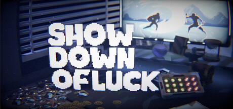

# Godot Voxel Support
[English](https://github.com/QinZhuo/GodotVoxelSupport/blob/main/README.md) | [中文](https://github.com/QinZhuo/GodotVoxelSupport/blob/main/zh/README.md)

[Github](https://github.com/QinZhuo/GodotVoxelSupport) • [Asset Library](https://godotengine.org/asset-library/asset/4480)

> MagicaVoxel large voxel model support, faster import speed, automatic material mapping

- Merge models
- Multi-threaded Mesh generation
- Automatically generate metal, roughness, emissive, and other maps
- Solves the issue of slow import and crashing when importing .vox models larger than 256x256x256



You can see the rendering effects of voxel models imported using this plugin in the game [Showdown of Luck](https://store.steampowered.com/app/4666770/?utm_source=github) — an asynchronous multiplayer PVP auto-battler that combines cards with slot machines.


## Voxel Runtime Usage

### Directory layout

Directories are **layers, not topics**: a file only ever imports from its own layer or one below it, so the dependency graph is acyclic by construction.

```
addons/VoxelSupport/
  plugin.gd            editor plugin entry (registers the four importers)
  Core/       (23)     leaf types with no layer dependency: VoxelChunk, VoxelVolume,
					   VoxelMaterial, VoxelSpec, QVoxelMate, QVoxelBlockCodec, NativeLoader,
					   VoxelStream / VoxelMemoryStream, VoxelDirtyLedger, VoxelLodGrid, ...
  Format/     ( 7)     .qvx / .vox byte layout: QVoxelFile, QVoxelBlockStream, QVoxelAsset,
					   VoxAsset, VoxAccess, VoxSpace, QVoxelFrame
  Model/      (10)     the in-memory project truth: QVoxelWorld, QVoxelModel, QVoxelNode,
					   QVoxelEvalEngine, QVoxelFileIO, VoxWriter, VoxAssetWorld, MeshVoxelWorld
  Mesh/       ( 4)     voxels -> geometry: VoxelMeshGenerator, VoxelChunkGenerator,
					   VoxelMaterialCache, MeshAccess (external mesh -> snapshot)
  Data/       ( 8)     runtime voxel data + persistence: QVoxelSource, QVoxelStream,
					   VoxelPersistence, VoxelAsyncLoader, VoxelEditKernel, VoxelRay,
					   VoxelPointCloudExporter, ProceduralVoxelSource
  Runtime/    ( 9)     everything that draws: VoxelRenderer, VoxelViewLayer, VoxelCollision,
					   VoxelParticleView, VoxelMesher, VoxelMeshBatch, VoxelDestructible,
					   VoxelDestructionPresenter, VoxelAnimator
  Tools/      ( 5)     scripting / export / preview / MCP: QVoxelScript, QVoxelBuilder,
					   QVoxelMeshExport, QVoxelPreview, QVoxelMCPTools
  Importer/   ( 5)     editor import plugins: mesh, MeshLibrary, .qvx source, noop
  Native/              GDExtension sources + prebuilt libraries
```

`Core → Format → Model → Mesh → Data → Runtime → Tools`, with `Importer` alongside `Tools`.

```
QVoxelSource                    — voxel storage & editing (materials, chunk buffers)
  ├─ VoxelStream (@abstract)     — STORAGE: chunk-level persistence API (all @abstract)
  │    ├─ QVoxelStream             — single-file .qvx block-stream world storage (disk)
  │    └─ VoxelMemoryStream      — memory only (no persistence; a home for edits)
  └─ node: QVoxelNode            — GENERATION: the data layer's single source of truth
	   └─ QVoxelModel            — bounded grid + modifier chain (run by QVoxelEvalEngine)

VoxelMesher                     — MESHING layer: voxels → geometry → ArrayMesh
								  (stateless, no node; both draw modes share it)
VoxelRenderer                   — DRAWING CORE: data → visible geometry
  └─ DrawMode.STATIC / DYNAMIC
	 STATIC  : whole model → 1 mesh (≤2 surfaces), shared across instances → auto-batched
	 DYNAMIC : per-chunk (or per-group) MeshInstance3D, incremental rebuild

Optional capability components (plain child nodes of VoxelRenderer):
  VoxelViewLayer                — streaming load/unload, LOD bands, frustum culling, origin shift
  VoxelCollision                — StaticBody3D + ConcavePolygonShape3D per chunk
  VoxelParticleView             — point cloud → GPUParticles3D
  VoxelDestructible             — destruction, collapse, falling debris (edited via VoxelEditKernel)
```

**Layer rules:**

1. **`VoxelRenderer` owns drawing, not viewpoint policy.** It keeps only `current_camera()` and the `view_distance` / `unload_distance` / `lod_count` knobs the view layer reads back; everything else (streaming, LOD banding, frustum culling, origin shift, destruction, particles) lives in `Runtime/` components.
2. **The simplest path must really be the simplest** — with `DrawMode.STATIC` and no components attached, no LOD/streaming code runs in the frame loop at all.
3. **Two draw modes are a deliberate tradeoff, not an optimisation switch:**

   | | draw calls (N instances) | cost of editing one voxel |
   |---|---|---|
   | `STATIC` (default) | ~N (auto-batched) | rebuilds the **whole** model (deer 1.6–3.1 ms / teapot1 85 ms) |
   | `DYNAMIC` | N × chunk count | rebuilds only the affected chunk (0.4–2 ms) |

   Use `STATIC` for static props / buildings / display models, `DYNAMIC` for anything you destroy or edit per-voxel. Measurements: `docs/渲染性能对比_QVX_vs_ArrayMesh.md`.

**Storage and generation are two parallel parts**: `stream` stores (disk or memory), `node` describes what to generate. They can coexist; lookup order is always **stream first** — anything stored is authoritative and is never overwritten by a freshly generated result. Pending/ready bookkeeping, dedup, throttling and background dispatch live in `VoxelAsyncLoader`.

**Data access order** (per chunk): memory buffer → stream → node. All mesh generation runs on `WorkerThreadPool`; the main thread never builds voxel meshes or generates chunks synchronously.

### Static world (disk streaming)

```gdscript
var data := QVoxelSource.new()
# ... add materials, fill voxels (set_voxel / set_voxels)

var stream := QVoxelStream.new()
stream.file_path = "user://my_world/world.qvx"
data.stream = stream

var renderer := VoxelRenderer.new()
renderer.data = data
renderer.voxel_scale = 0.2
renderer.draw_mode = VoxelRenderer.DrawMode.DYNAMIC   # streaming + LOD needs DYNAMIC
renderer.visibility_mode = VoxelRenderer.VisibilityMode.STREAMING
renderer.view_distance = 60.0
renderer.unload_distance = 100.0
renderer.lod_count = 4   # 4 levels (LOD0 full precision + LOD1/2/3, each ×2 coarser),
						  # band radii derived from view_distance automatically
```

### Procedural infinite world

```gdscript
class_name MyWorld
extends ProceduralVoxelSource

## Only generate() is required: the base fills is_streaming / can_generate_chunk /
## is_in_node_bounds and configures the async loader at construction.
## Return a 32³ PackedInt32Array (lod=0) or LOD_BLOCK_SIZE³ (lod>=1), value = material id, 0 = empty.
## Must be deterministic: same chunk_key → same terrain.
func generate(chunk_key: Vector3i, lod: int = 0) -> PackedInt32Array:
	# e.g. noise-based heightmap — use ABSOLUTE voxel y for cross-layer continuity
	...

# usage: the source GENERATES, the stream STORES (swap freely, independently)
var data := MyWorld.new()
data.infinite = true                      # enables origin shift
data.stream = QVoxelStream.new()          # player edits go to disk, survive restart
data.stream.file_path = "user://world_edits/world.qvx"
# assign to VoxelRenderer.data (recommend visibility_mode = STREAMING)
```

> Swap `stream` for `VoxelMemoryStream` to keep edits in memory only; leave it unset and a memory stream is used automatically. The generation code never changes.

- **Deterministic** — same chunk_key → same terrain, continuous across borders and origin shifts
- **Origin shift** — the world origin auto-shifts when the camera travels far, keeping coordinates float32-safe
- **Edit persistence** — player-modified chunks go through `stream` and survive restart
- **Async generation** — chunks generate on background threads; the main thread only submits/collects
- **Auto-unload** — meshes, LOD0 chunk data and coarse LOD blocks beyond range are dropped and rebuilt on return; LOD0 *data* unloads on a wider radius (`unload_distance` plus the coarsest block's extent) so coarse downsampling keeps its source

### Destruction & collapse

```gdscript
# Destruction is a COMPONENT, not a subclass:
#   VoxelRenderer (drawing)  +  VoxelDestructible (editing, child node)
var renderer := VoxelRenderer.new()
renderer.data = data
renderer.draw_mode = VoxelRenderer.DrawMode.DYNAMIC   # REQUIRED: STATIC rebuilds the whole model per edit
add_child(renderer)

var target := VoxelDestructible.new()
renderer.add_child(target)
target.configure(renderer)

target.damage_sphere(center, radius)
target.damage_voxel(pos)
target.damage_ray(origin, direction, max_distance)
```

Options: `use_voxel_health` / `damage_per_voxel` / `collapse_mode` / `local_collapse` / `falling_mode` / `stress_force` / `spawn_debris_on_damage`, etc. Debris is GPU-particle based (no per-chunk physics bodies).

### Configuration — auto-hidden when not applicable

| Property | Effective when | Hidden when |
|---|---|---|
| `view_distance` / `unload_distance` / `lod_count` | visibility_mode ≠ FULL | visibility_mode = FULL |
| `_collision_rebuild_per_frame` / `collision_rebuild_budget_ms` | generate_collision = true | generate_collision = false |
| `group_shift` | draw_mode = DYNAMIC | draw_mode = STATIC |
| `max_debris_per_hit` / `debris_*` | spawn_debris_on_damage = true | spawn_debris_on_damage = false |

### Common pitfalls

- **`draw_mode` is the first thing to get right.** `STATIC` merges the whole model into one mesh so the engine can batch instances (matches imported ArrayMesh), but editing one voxel rebuilds everything. Anything destroyed / edited per-voxel **must** use `DYNAMIC`.
- **`group_shift` (DYNAMIC only, default 0).** 0 = one draw unit per chunk (cheapest per edit). `1`/`2` group 8/64 chunks into one draw unit — fewer draw calls (teapot1: 158 → 35 → 8) but the whole group is rebuilt on edit, on the main thread.
- **Procedural world**: extend `ProceduralVoxelSource` (it reports `is_streaming() = true`; the renderer gate uses that instead of `node != null`). `visibility_mode = STREAMING` is still recommended so unload/LOD distance logic is active.
- `lod_count = 1` disables LOD; for large worlds set `lod_count >= 2`. Band radii: LOD0 = `view_distance / 2^lod_count`, LOD_i (i>=1) = `view_distance / 2^(lod_count-1-i)`.
- `unload_distance = 0` falls back to `view_distance * 1.2`
- `generate_collision` is **false by default**. Collision rebuild is count- and time-budgeted (`collision_rebuild_budget_ms`, default 4ms); one chunk may still exceed the budget, so lower it if your chunk meshes are very dense.
- `voxel_scale` = world units per voxel; all distances are in world units.
- **The native library is a hard dependency** — mesh generation, destruction and CRC all live in `addons/VoxelSupport/Native/` (GDExtension `VoxelSupportNative`). If it is missing or version-mismatched, the plugin logs one error and draws nothing; there is no GDScript fallback.
- **Asset origin is one shared import option: `mesh/origin`** — default `world_origin` keeps the file's coordinates (a `.vox` stays where the author put it; a `.qvx` uses its stored coordinates as-is). Also pick `bottom_center` (X/Z centred, bottom at `Y = 0`) or `content_center` (Blender's "Center Origins"). The Mesh and Voxel Data importers read the same option.
- **`.vox` and `.qvx` have separate asset adapters** — `.vox` uses `VoxAsset.from_asset()`; `.qvx` uses `QVoxelAsset.from_file()`. `VoxAsset.from_asset()` on a `.qvx` returns null with a warning; the import plugins dispatch by extension.

### Streaming demo

`res://demo/test_world_demo.tscn` — **key 1** cycles `FULL` / `FRUSTUM` / `STREAMING`; **key 2** cycles `group_shift`; **key 5** orbits the camera for an FPS sweep. Controls: WASD move, Q/E up/down, Space fast, left click destroys a sphere, Space casts a destruction ray.

## Voxel particles (low-level interface)

Render a voxel model **as a cloud of voxel cubes**. The plugin provides only this mechanism and **implements no effects** — floating, dissolving, assembling and A→B morphing are your project's presentation.

```gdscript
$VoxelRenderer.display_mode = VoxelRenderer.DisplayMode.PARTICLES   # switch to particles (mesh hidden)
$VoxelRenderer.voxel_shape = VoxelRenderer.VoxelShape.SPHERE    # cube / sphere
var node := $VoxelRenderer.particle_node    # a GPUParticles3D with the point cloud already uploaded
node.process_material = my_particles_shader # replace it; decide how particles move
$VoxelRenderer.particle_points              # the point data (PackedFloat32Array)
```

Demo: `res://demo/particle_demo.tscn` (1 static / 2 float / 3 scatter / 4 gather / T toggle mesh↔particles / F toggle shape).

### Two enums control what you see

| Enum | Values | Meaning |
|---|---|---|
| `DisplayMode` | `MESH` / `PARTICLES` | merged-face mesh (default) or one cube per voxel |
| `VoxelShape` | `CUBE` / `SPHERE` | draw each particle as a cube or a sphere; switching **does not** rebuild the particle node |

Sphere geometry is generated by the plugin (`SphereMesh`, three tiers via `sphere_subdivisions`), with `sphere_scale` as the radius relative to the voxel edge — the same two properties the mesh path uses.

### Where the data comes from: `QVoxelSource.build_particle_points()`

The point cloud is a **derived query** on `QVoxelSource`: recomputable at any time, never saved to disk.

```gdscript
# Just the point array (for your own pairing / offsets)
var pts := source.build_particle_points(0.1, 200000, true)

# Or with GPU textures ready to upload (this is what the renderer uses internally)
var tex := source.build_particle_textures(0.1, 200000, true)
tex["positions"]   # ImageTexture RGBAF: xyz
tex["colors"]      # ImageTexture RGBAF: linear albedo + opacity
tex["props"]       # ImageTexture RGBAF: metal / rough / emission
tex["grid_width"]  # what the shader uses to map INDEX to a texel
```

**12 floats per point** (`QVoxelSource.PARTICLE_STRIDE`):

| Offset | Content |
|---|---|
| `P_POS` (0) +0..2 | world position = (voxel + center_offset) × scale, exactly matching the mesh renderer |
| `P_MAT` (3) | material id |
| `P_COLOR` (4) +0..2 | albedo (sRGB) |
| `P_SEED` (7) | stable random 0..1 (same voxel → same value) |
| `P_EMIT` (8) | emission 0..1 |
| `P_METAL` (9) | metallic 0..1 |
| `P_ROUGH` (10) | roughness 0..1 |
| `P_TRANS` (11) | transparency 0..1 (0 = opaque) |

### Visual fidelity: what must be right

| Problem | Symptom | Fix |
|---|---|---|
| Hard-coded particle size | Cubes 5× the voxel size, occluding each other | edge = `voxel_scale × particle_scale` |
| Colour space (double gamma) | Darks brightened >2×, washed out | `srgb_to_linear()` at bake time (`FORMAT_RGBAF` is linear) |
| Colour only, no material | Metal has no metallic feel; glass is a solid slab | output `METALLIC / ROUGHNESS / EMISSION` |
| One material can't separate opaque/transparent | Either see-through, or glass culls what's behind it | **two draw passes**, split by alpha |
| Opaque pass writes ALPHA | Classified as transparent → no depth | the opaque pass must **never write ALPHA** |
| Surface filter drops glass | Windows vanish outright | **always keep transparent voxels** |
| Forgetting `preprocess` | Only a few stray points appear | `preprocess = lifetime` |

Measured (cars.vox): mean luminance differs by **1.5%**, mean per-pixel difference **0.065**, metallic mean difference **0.7%**, zero clipped white pixels on both sides.

### Optional pairing helper: `VoxelMorphMap`

```gdscript
var map := VoxelMorphMap.build(a_points, b_points)   # Morton-sorted pairing by default
map.b_index[i]   # point i of A -> point b_index[i] of B
```

Measured on 20k points: Morton ≈30 ms with mean pairing distance 0.418; sorted-axis 130 ms / 1.039; spatial hash 0.108 but 30% slower; greedy O(n²) already >2 s at 5k points.

## Voxel modeling (QVoxelier + scripts)

`res://QVoxelier/QVoxelier.tscn` is a standalone voxel modeler built on this plugin. Its whole capability is exposed to code through **`QVoxelScript`** — one method per UI action (models, groups, materials, voxels, frames, cameras, file I/O, mesh export) — which is what the MCP `voxel_help` tool / `voxel://api` resource documents: `new_model` → `material` → `paint(VoxelPrimitives.*)` → `save`.

`.qvx` is the project file (lossless), `.vox` the MagicaVoxel exchange format (≤ 256, 90° rotations, integer offsets, current frame only) — see `docs/QVX_FORMAT.md`.

Preview without opening the app: `await QVoxelScript.preview("user://shot.png", {"file": "user://m.qvx"})` renders the world offscreen to a PNG (MCP tool: `voxel_render`).
