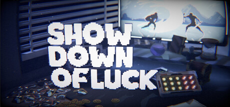

# Godot Voxel Support
[English](https://github.com/QinZhuo/GodotVoxelSupport/blob/main/README.md) | [中文](https://github.com/QinZhuo/GodotVoxelSupport/blob/main/zh/README.md)

[Github](https://github.com/QinZhuo/GodotVoxelSupport) • [资产库](https://godotengine.org/asset-library/asset/4480) 

> MagicaVoxel大型体素模型支持，更快的导入速度，自动材质贴图

- 合并模型 
- 多线程生成Mesh
- 自动生成 金属 粗糙 自发光 等贴图
- 解决导入大于256x256x256的.vox模型过慢导致卡死的问题



[《Showdown of Luck》](https://store.steampowered.com/app/4666770/?utm_source=github)这个游戏中可以看到使用插件导入的体素模型渲染效果 是现在我正在制作的独立游戏 一款融合卡牌与老虎机的异步联机PVP自走棋游戏 感兴趣可以加一个愿望单
> 如果您的游戏使用了这个插件 跟我说一下我会很开心 我也愿意通过我的方式帮你宣传一下


## 体素运行时使用方法

### 架构

```
QVoxelSource                    — 体素数据存储与修改（材质、chunk 缓冲）
  ├─ VoxelStream (@abstract)     — 存储：chunk 级持久化 API（全部方法 @abstract）
  │    ├─ QVoxelStream             — .qvx 单文件块流世界存档（磁盘）
  │    └─ VoxelMemoryStream      — 纯内存（不落盘；程序化世界的编辑落脚处）
  └─ node: QVoxelNode            — 生成：数据层的唯一求值来源
       └─ QVoxelModel            — 有界盒 + 修改器链（由 QVoxelEvalEngine 求值）
VoxelRenderer              — 异步网格生成、LOD、流式加载、碰撞
VoxelDestructible          — 继承 VoxelRenderer：破坏、崩塌、掉落碎片
```

**"存"与"造"是两个并列的部件**：`stream` 负责存（磁盘 / 内存），`node` 负责造
（程序化地形经由它的修改器链）。二者可以同时存在（程序化世界 + 破坏存档），取数优先级恒为
**流 > 节点**——存过的必须权威，不能被重新生成覆盖。
登记 / 去重 / 后台派发 / 回填集中在 `VoxelAsyncLoader` 一处，两个数据源都只回答
"存了吗"与"能造吗"两个同步问题（后者是虚函数 `can_generate_chunk()`，无限世界扩展覆写它）。

**数据访问顺序**（每 chunk）：内存缓冲 → 流 → 节点。
所有网格生成在后台线程（`WorkerThreadPool`），主线程不阻塞于体素生成/建网格。

### 静态世界（磁盘流式）

```gdscript
var data := QVoxelSource.new()
# ... 添加材质、填充体素（set_voxels / load_voxels_dict）

var stream := QVoxelStream.new()
stream.file_path = "user://my_world/world.qvx"
data.stream = stream

var renderer := VoxelDestructible.new()
renderer.data = data
renderer.voxel_scale = 0.2
renderer.visibility_mode = VoxelRenderer.VisibilityMode.STREAMING
renderer.view_distance = 60.0
renderer.unload_distance = 100.0
renderer.lod_count = 4   # 多级 LOD：4 层（LOD0 全精度 + LOD1/2/3 每级 ×2 粗化），
                         # 各层距离由 view_distance 自动等比（×2）推导
```

### 程序化无限世界

```gdscript
class_name MyWorld
extends QVoxelSource

## 无限世界：先声明，再覆写供数钩子。
func can_generate_chunk(_chunk_key: Vector3i) -> bool:
	return true

## 返回 32³ PackedInt32Array（值 = 材质ID，0 = 空）。
## 必须确定性：同 chunk_key → 同地形。
func _generate_chunk(chunk_key: Vector3i) -> PackedInt32Array:
	# 例如基于噪声的高度图 —— 用【绝对体素 y】判断，保证跨层连续
	...

# 使用：数据层"造"，存储"存"（可自由替换，互不影响）
var data := MyWorld.new()
data.infinite = true                      # 开启 origin shift
data.stream = QVoxelStream.new()          # 玩家修改落盘，重启保留
data.stream.file_path = "user://world_edits/world.qvx"
# 赋值给 VoxelRenderer.data（建议 visibility_mode = STREAMING）
```

> `stream` 换成 `VoxelMemoryStream` 即"修改只存内存、退出即丢"；留空则由引擎自动兜底
> 建一个内存流。生成代码一行都不用改。

特性：
- **确定性** — 同 chunk_key → 同地形，chunk 边界与 origin shift 后世界连续
- **动态原点重定位（origin shift）** — 相机远移自动平移世界基准，坐标保持小（float32 精度安全）→ 真正的无限世界
- **修改持久化** — 玩家修改的 chunk 由 `stream` 负责，重启保留
- **异步生成** — chunk 生成在后台线程（`WorkerThreadPool`），主线程只提交/回填
- **自动卸载** — 超出距离的网格、LOD0 chunk 数据与粗层 LOD 块都会被释放，回来时重新加载/生成。
  LOD0 **数据**的卸载半径比网格更宽（`unload_distance` 再加最粗层 block 的覆盖范围），
  以保证粗层降采样仍有 LOD0 来源；这是无限世界内存有界的前提

### 破坏与崩塌

```gdscript
var target := renderer as VoxelDestructible
target.damage_sphere(center, radius)
target.damage_voxel(pos)
target.damage_ray(origin, direction, max_distance)
```

可选配置：`use_voxel_health` / `damage_per_voxel` / `collapse_mode` / `local_collapse` /
`falling_mode` / `stress_force` / `spawn_debris_on_damage` 等。
碎片基于 GPU 粒子（无逐 chunk 物理刚体）。

### 配置项 — 不生效时自动隐藏

相关属性在 **Inspector 中条件不满足时自动隐藏**（避免设置后无效）：

| 属性 | 生效条件 | 隐藏条件 |
|---|---|---|
| `view_distance` / `unload_distance` / `lod_count` | visibility_mode ≠ FULL | visibility_mode = FULL |
| `_stream_load_per_frame` / `_stream_unload_per_frame` | visibility_mode = STREAMING | 其他 |
| `_lod1_build_per_frame` / `_lod1_build_budget_ms` | lod_count > 1 | lod_count = 1 |
| `_collision_rebuild_per_frame` | generate_collision = true | generate_collision = false |
| `max_debris_per_hit` / `debris_*` | spawn_debris_on_damage = true | spawn_debris_on_damage = false |

### 常见易错点

- **程序化世界**：使用 `visibility_mode = STREAMING` — 无限世界必然按距离驱动（FULL/FRUSTUM 曾会导致空白，已自动修复）
- `lod_count = 1` 表示关闭 LOD（全部全精度）；大世界设 `lod_count >= 2`。
  分带半径自动推导：LOD0 = `view_distance / 2^lod_count`，LOD_i（i≥1）= `view_distance / 2^(lod_count-1-i)`
  ——自 LOD0 起逐级 ×2，对齐 Voxel Tools 标准做法
- `unload_distance = 0` 会自动回退到 `view_distance * 1.2`
- `generate_collision` **默认 false** — 需要物理碰撞时开启
- `voxel_scale` = 每个体素的世界单位（数据坐标是 1 体素单位）；所有距离参数都是世界单位
- **原生库是硬依赖** —— 网格生成 / 破坏 / CRC 全在 `addons/VoxelSupport/Native/`（GDExtension
  `VoxelNative`）。库缺失或版本不匹配时插件只报一次明确错误、不做 GDScript 兜底。
- **资产原点由导入选项 `mesh/origin` 统一控制（Mesh 与 Data 两个导入器同名同义）** —— 默认
  `world_origin` = 原样保留文件里的坐标：`.vox` 就停在作者把它放在 MagicaVoxel 世界里的位置
  （模型自己的 `SIZE` 盒中心 + 每层 `nTRN`/`NODE` 变换）；`.qvx` 没有"世界"这一层，此时就是
  "文件里的坐标原样"。这也正是本插件网格导入一直以来的行为，因此升级不会挪动已有资产，多模型装配
  的相对位置也保得住。需要游戏资产惯用的原点（按内容 X/Z 居中、底面落在 `Y=0`）就显式选
  `bottom_center`，要三轴内容居中（与 Blender 导入器的 "Center Origins" 同思路）就选
  `content_center`。
- **`.vox` 与 `.qvx` 各有自己的资产适配器** —— `.vox`（MagicaVoxel 场景图）走
  `VoxAsset.from_asset()`；`.qvx`（一个 `VXEL` 一个模型 + `NODE` 摆放）走
  `QVoxelAsset.from_file()`。对 `.qvx` 调 `VoxAsset.from_asset()` 会**报错并返回 null**：
  把 MagicaVoxel 的形状硬套到 QVX 上会静默丢掉 `NODE` 场景图与除第一个之外的全部模型。
  编辑器的导入插件已按扩展名自动分派，无需手动区分。

### 流式 demo

`res://demo/streaming_demo.tscn` — 按键 **0** 在 磁盘文件流 与 程序化无限世界 间切换。
操作：WASD 移动、Q/E 升降、空格加速、1 流式开关、2 视锥剔除开关。

## 体素粒子（底层接口）

把体素模型**显示成一大堆体素方块**。插件只提供这一层机制，**不实现任何具体动效** ——
漂浮、消散、聚合、A→B 变形都是你的项目的表现效果，应该由项目自己写。

```gdscript
$VoxelRenderer.display_mode = VoxelRenderer.DisplayMode.PARTICLES   # 切到粒子（自动隐藏网格）
$VoxelRenderer.particle_shape = VoxelRenderer.ParticleShape.SPHERE  # 方块 / 球
var node := $VoxelRenderer.particle_node    # 一个已填好点云的 GPUParticles3D
node.process_material = my_particles_shader # 换掉它，自己决定粒子怎么动
$VoxelRenderer.particle_points              # 点数据（PackedFloat32Array）
```

演示：`res://demo/particle_demo.tscn`（1 静态 / 2 漂浮 / 3 散开 / 4 聚合 / T 切网格与粒子 / F 切形状）。
它展示**两种自定义方式**：改 uniform（漂浮），或换整个 process 着色器（散开/聚合）。

### 两个枚举控制显示

| 枚举 | 取值 | 说明 |
|---|---|---|
| `DisplayMode` | `MESH` / `PARTICLES` | 网格（合并面片，默认）还是粒子（每体素一个方块） |
| `ParticleShape` | `CUBE` / `SPHERE` | 粒子画成方块还是球；换形状**不重建粒子节点**，只换 draw pass 的网格 |

球的几何也在插件侧生成（`SphereMesh`，按 `particle_sphere_subdivisions` 分 6/10/18 环三档），
`particle_sphere_scale` 控制相对体素边长的半径。它与网格路径的 `mesh/shape = sphere` 是同一个观感目标，
只是网格那边是导入期烘焙、粒子这边是运行时换 draw mesh。

`particle_mode` 布尔保留为**兼容别名**（读写都同步到 `display_mode`），新代码请用枚举。

### 数据从哪来：`QVoxelSource.build_particle_points()`

**没有单独的点云资源类** —— 那是同一份数据的第二种视图，会引入"两套真值谁先更新"的问题。
点云是 `QVoxelSource` 的一个**派生查询**，随时可重算、不落盘：

```gdscript
# 只拿点数组（自己算配对/偏移用）
var pts := source.build_particle_points(0.1, 200000, true)

# 或者连 GPU 纹理一起拿（渲染器内部就是这么用的）
var tex := source.build_particle_textures(0.1, 200000, true)
tex["positions"]   # ImageTexture RGBAF：xyz
tex["colors"]      # ImageTexture RGBAF：线性基色 + 不透明度
tex["props"]       # ImageTexture RGBAF：metal / rough / emission
tex["grid_width"]  # 着色器用它把 INDEX 映射到纹素
```

**每点 12 个 float**（`QVoxelSource.PARTICLE_STRIDE`）：

| 偏移 | 内容 |
|---|---|
| `P_POS` (0) +0..2 | 世界坐标 = (体素坐标 + center_offset) × scale，**与网格渲染完全重合** |
| `P_MAT` (3) | 材质 ID |
| `P_COLOR` (4) +0..2 | 基色（sRGB） |
| `P_SEED` (7) | 稳定随机 0..1（由坐标决定，同一格恒同值） |
| `P_EMIT` (8) | 自发光 0..1 |
| `P_METAL` (9) | 金属度 0..1 |
| `P_ROUGH` (10) | 粗糙度 0..1 |
| `P_TRANS` (11) | 透明度 0..1（0 = 不透明） |

### 观感保真：几个必须做对、做错了不报错的地方

渲染器已经把这些处理好了。若你自己写 process 着色器，注意别把它们弄丢：

| 问题 | 现象 | 正确做法 |
|---|---|---|
| 粒子尺寸写死 | 方块比体素大 5 倍，前层遮后层，像被透视 | 边长 = `voxel_scale × particle_scale` |
| 颜色空间（双重 gamma） | 暗部提亮一倍以上、整体发白变平 | 烘焙时 `srgb_to_linear()`（`FORMAT_RGBAF` 是线性纹理） |
| 只带颜色、不带材质 | 金属没金属感、玻璃是实心色块 | 输出 `METALLIC / ROUGHNESS / EMISSION`，走真 PBR |
| 单一材质分不开透明/不透明 | 要么透视，要么玻璃把后面的体素裁没 | **拆成两个 draw pass**，靠 alpha 分流 |
| 不透明通道写了 ALPHA | 公式上被归为透明材质 -> 不写深度 -> 透视 | 不透明通道**绝对不要写 ALPHA** |
| 表面过滤误删玻璃 | 车窗整片消失 | 透明体素**永远保留**（被包住也看得见后面） |
| 忘设 `preprocess` | 只有零星几个点，像没生效 | `preprocess = lifetime`，粒子一开始就全部存在 |

实测（cars.vox，同机位同环境）：网格与粒子的平均亮度差 **1.5%**、逐像素平均差 **0.065**、
金属部分平均亮度差 **0.7%**、过曝纯白像素两边都是 **0**。

### 可选的配对工具：`VoxelMorphMap`

A→B 变形需要算"A 的第 i 个点该飞向 B 的第几个点"。这是**算法**不是**效果**，故留作工具类：

```gdscript
var map := VoxelMorphMap.build(a_points, b_points)   # 默认 Morton 排序配对
map.b_index[i]   # A 的第 i 个点 -> B 的第 b_index[i] 个点
```

按索引硬配会让粒子满天乱飞拉出交叉长线。实测 2 万点：Morton 约 30ms、平均配对距离 0.418；
单轴排序 130ms / 1.039；空间哈希 0.108 但慢 30%；贪心 O(n²) 在 5000 点就 >2 秒，不可用。
## 体素建模（QVoxelier + 脚本）

`res://QVoxelier/QVoxelier.tscn` 是基于本插件的独立体素建模软件。它界面上能做的每个动作，
代码侧都有对应方法 —— 统一入口 **`QVoxelScript`**（模型 / 组 / 材质 / 体素 / 帧 / 相机 /
文件读写 / 网格导出），也就是 MCP 的 `voxel_help` 工具与 `voxel://api` 资源里的那份说明，
所以 AI 不开界面也能建模：`new_model` → `material` → `paint(VoxelPrimitives.*)` → `save`。

`.qvx` 是工程文件（无损），`.vox` 是 MagicaVoxel 交换格式（≤256、90° 旋转、整数平移、
只写当前帧）—— 详见 `docs/QVX_FORMAT.md`。

不开软件也能确认造型：`await QVoxelScript.preview("user://shot.png", {"file": "user://m.qvx"})`
把世界**离屏渲成 PNG**（MCP 侧是 `voxel_render`），不走导入管线、不需要 `reimport`。
